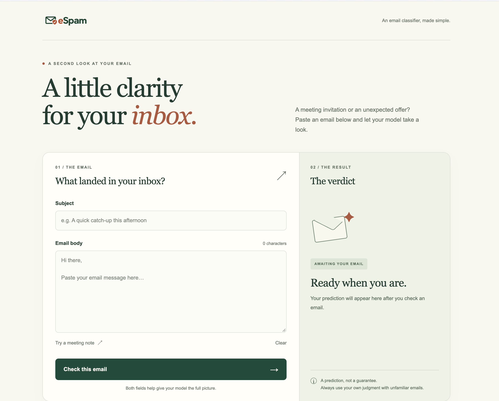
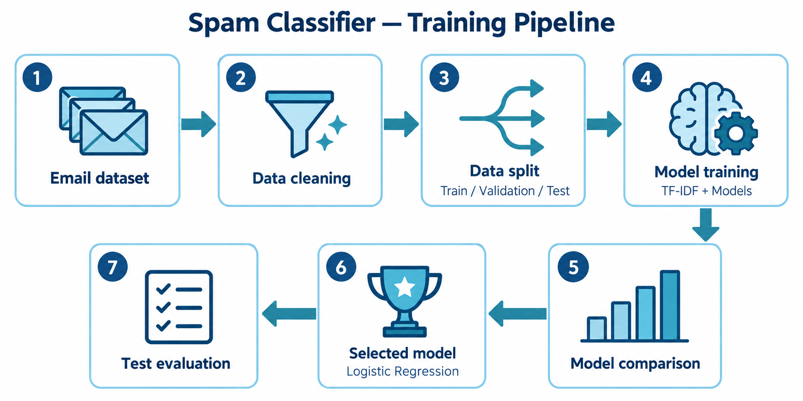
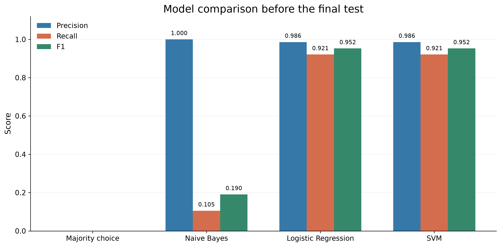
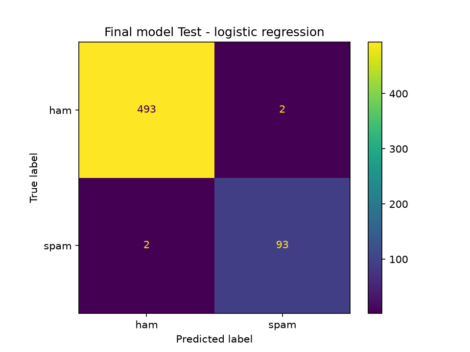

# Spam Email Classifier

A personal project by **Mohamed Aassou**. Enter an email subject and message, and the web page predicts whether it is **spam** or **legitimate mail**. The project also documents how the email data was prepared, how several models were compared, and how the chosen model performed on a separate test set.

[Read the full report](<reports/spam-classifier/Spam Email Classifier - Report.pdf>) · [View the report source](reports/spam-classifier/main.tex)

<p align="center">
  
</p>

## How it works

The project uses the public [SpamAssassin email collection](https://spamassassin.apache.org/old/publiccorpus/). It prepares each email's subject and body, compares several approaches on a validation group, then tests the chosen model on emails kept aside until the end. The web page sends a new email to the saved model and displays its prediction.

<p align="center">
  
</p>

The diagram is a simplified overview. The report explains the data split and the final training step in more detail.

## Results

The starting point always predicts the most common class, so it catches no spam. On the validation group, **Logistic Regression and SVM had the same recorded precision, recall and F1 scores**. The project uses Logistic Regression for the final model.



On the reserved test group, the final model made **586 correct predictions out of 590**:

| Measure | Final test result |
|---|---:|
| Accuracy | 99.32% |
| Spam precision | 97.89% |
| Spam recall | 97.89% |
| Spam F1 | 97.89% |

It incorrectly flagged two legitimate emails and missed two spam emails. In the image below, **ham** means legitimate mail; rows are the real labels and columns are the predictions.

<p align="center">
  
</p>

These results describe this test group from an older email collection. They do not establish how the model would perform on current incoming mail.

## Install and run

You need [Git](https://git-scm.com/) and [uv](https://docs.astral.sh/uv/getting-started/installation/). The project specifies Python 3.12 in `.python-version`; uv can prepare the project environment when you install the dependencies. An internet connection is needed for the first setup and to download the public email data.

1. Clone the project and enter its folder:

   ```sh
   git clone https://github.com/mohammedaassou/Spam-Email-Classifier.git
   cd Spam-Email-Classifier
   ```

2. Install the project dependencies:

   ```sh
   uv sync
   ```

3. Download the email collection and train the model:

   ```sh
   uv run train
   ```

   This creates the local dataset and a saved model at `artifacts/spam_classifier.joblib`. The first run also downloads the English word list used to prepare emails. Training takes longer than later predictions.

4. Start the web application from the project root:

   ```sh
   uv run start
   ```

5. Open **http://127.0.0.1:8000** in your browser. Enter a subject and email body, then select **Check this email**. Stop the server with `Ctrl+C`.

The saved model and downloaded emails are local files and are not included in a fresh clone. If you already trained the model, you can skip step 3 on later runs.

## Main technologies

<p align="center">
  <a href="https://www.python.org/"></a>&nbsp;&nbsp;
  <a href="https://pandas.pydata.org/"></a>&nbsp;&nbsp;
  <a href="https://scikit-learn.org/"></a>&nbsp;&nbsp;
  <a href="https://fastapi.tiangolo.com/"></a>&nbsp;&nbsp;
  <a href="https://matplotlib.org/"></a>
</p>

Python runs the project; pandas prepares the dataset; scikit-learn builds and evaluates the models; FastAPI serves the web page and prediction request; Matplotlib creates the charts. NLTK, Jinja2 and Uvicorn support text preparation, page rendering and the local server. [Logo sources](reports/spam-classifier/TECH_LOGOS.md) are recorded with the report.

## Report and project scope

The [PDF report](<reports/spam-classifier/Spam Email Classifier - Report.pdf>) contains the data description, model comparison, evaluation figures, application workflow and limitations. To rebuild it locally, install [Tectonic](https://tectonic-typesetting.github.io/) and run:

```sh
cd reports/spam-classifier
tectonic -X compile main.tex
```

The application runs locally. It does not connect to an inbox or move messages, and the web page currently shows a class label rather than a spam probability.
